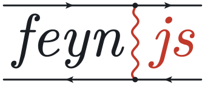
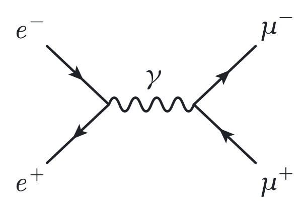
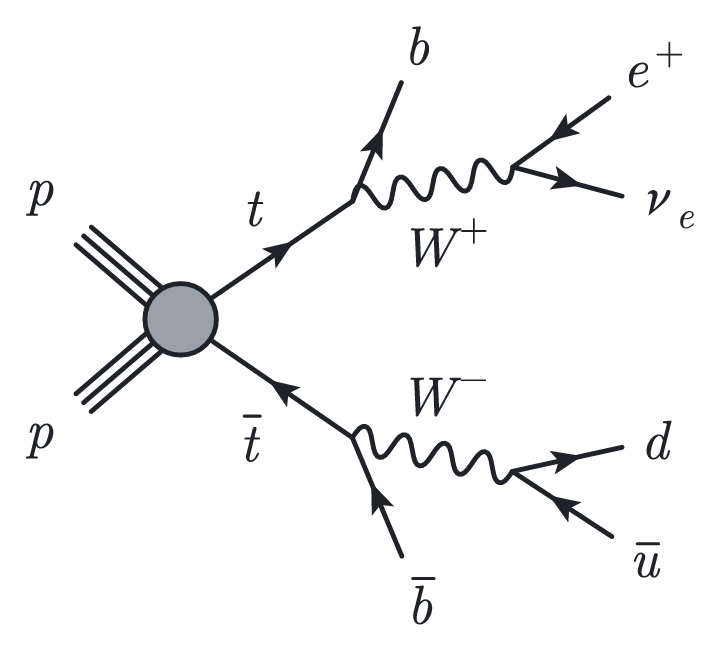
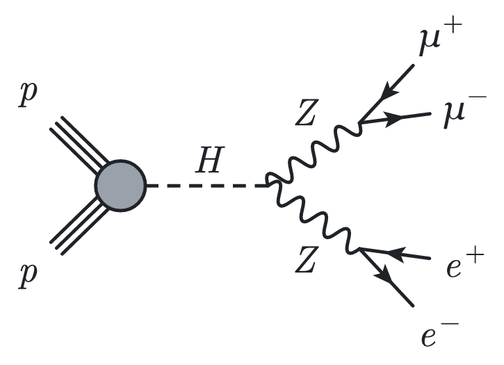

<p align="center">
  <picture>
    <source media="(prefers-color-scheme: dark)" srcset="docs/brand/logo/logo-ink-red-dark.svg">
    
  </picture>
</p>

<p align="center">
  <a href="https://github.com/hepjs/feynjs/actions/workflows/ci.yml"></a>
  <a href="https://github.com/hepjs/feynjs/actions/workflows/platforms.yml"></a>
  <a href="https://github.com/hepjs/feynjs/releases/latest"></a>
  <a href="https://www.npmjs.com/package/feynjs"></a>
  <a href="https://www.npmjs.com/package/feynjs"></a>
  <a href="https://www.jsdelivr.com/package/npm/feynjs"></a>
  <a href="https://hepjs.github.io/feynjs/"></a>
  <a href="LICENSE.md"></a>
  <a href="https://doi.org/10.5281/zenodo.24497761"></a>
</p>

# feynjs

**A JavaScript engine for Feynman diagrams.** Write a diagram as text; feynjs lays it out and
draws it, on the web, in Markdown and in TeX.

Feynman diagrams have lived in TeX: drawn in TikZ-Feynman with each vertex placed by hand, then
pasted into web pages and notes as images that no longer match their source. feynjs places every
vertex itself, following the conventions of published diagrams (time left to right; s- and
t-channels, cascades, loops and hadrons as papers draw them), and each particle sets its own line,
arrow and label. Because it is JavaScript, the browser draws the diagram as SVG in the page, in the
page's colours; the same source gives TikZ-Feynman code for a paper.

Write every line, as in TikZ-Feynman:

```feynman
i1 [e-] -- a -- i2 [e+]
a -- [gamma] b
f1 [mu-] -- b -- f2 [mu+]
```

<p align="center">
  <picture>
    <source media="(prefers-color-scheme: dark)" srcset=".github/readme/edges-dark.png">
    
  </picture>
</p>

or name the process and its decays, as in MadGraph:

```feynman
p p > t t~
t > b W+(> e+ ve)
t~ > b~ W-(> d u~)
```

<p align="center">
  <picture>
    <source media="(prefers-color-scheme: dark)" srcset=".github/readme/process-dark.png">
    
  </picture>
</p>

**Documentation, examples and a live playground: <https://hepjs.github.io/feynjs/>**

## Get it

| | |
|---|---|
| **npm** | `npm install feynjs` ([npmjs.com/package/feynjs](https://www.npmjs.com/package/feynjs)) |
| **CDN** | `<script src="https://cdn.jsdelivr.net/npm/feynjs@0.10/dist/feynjs.min.js"></script>` |
| **Release files** | `feynjs.min.js`, `feynjs.mjs`, the Obsidian plugin and the MadGraph plugin, from the [latest release](https://github.com/hepjs/feynjs/releases/latest) |
| **Archive** | every release on Zenodo, [10.5281/zenodo.24497761](https://doi.org/10.5281/zenodo.24497761) |
| **LaTeX package** | [`integrations/latex/feynjs.sty`](integrations/latex/) |

## Use it

**A web page.** One script tag; every ```` ```feynman ```` code block and `<div class="feynman">`
is drawn once the page has loaded:

```html
<script src="https://cdn.jsdelivr.net/npm/feynjs@0.10/dist/feynjs.min.js"></script>
```

**A Markdown site** (Zensical, MkDocs): the script, and `feynman` blocks passed through as they are:

```toml
[project]
extra_javascript = ["https://cdn.jsdelivr.net/npm/feynjs@0.10/dist/feynjs.min.js"]

[project.markdown_extensions]
pymdownx.superfences.custom_fences = [
  { name = "feynman", class = "feynman", format = "pymdownx.superfences.fence_div_format" },
]
```

**Obsidian.** Unzip `feynjs-obsidian.zip` from the
[latest release](https://github.com/hepjs/feynjs/releases/latest) into your vault's
`.obsidian/plugins/`; `feynman` blocks draw in your notes.

**LaTeX.** Write diagrams in a document with the [`feynjs` package](integrations/latex/);
`feynjs cache` writes each as TikZ-Feynman code with every vertex placed, so the document compiles
anywhere TikZ-Feynman does, Overleaf and arXiv included.

```latex
\usepackage{feynjs}
\begin{feynjs}
p p > t tbar
\end{feynjs}
```

**JavaScript and the command line.**

```js
import { render, toTikz } from "feynjs";
const svg = render("g g > {t} > H");
```

```sh
npx feynjs render diagram.feyn > diagram.svg     # also: tikz, check, describe, explain, measure
```

**MadGraph.** Drop `feynjs-madgraph.zip` from the
[latest release](https://github.com/hepjs/feynjs/releases/latest) into MadGraph's `PLUGIN`
directory; `mg5_aMC --mode=feynjs`, then `feynjs DIR`, draws every diagram of a process.

## What it draws

<p align="center">
  <picture>
    <source media="(prefers-color-scheme: dark)" srcset=".github/readme/higgs-dark.png">
    
  </picture>
</p>

- **Diagrams** from lines or processes: loops (`{t}`), production modes (`ggF`, `VBF`, `VBS`),
  decays in place (`W+(> e+ ve)`), panels side by side.
- **Particles** by name, TikZ-Feynman and MadGraph alike (`t~`, `ve`, `W+`): line style, arrow,
  label and properties follow; supersymmetric particles in colour.
- **Hadrons** as ellipses, braces or caps, quarks inside with their colour flux tubes, and
  **nuclei** from hydrogen to lead.
- **Colour flow**, **charge colour**, and **detector objects**: jets, large-R jets with their
  contents, taus, missing energy, semi-visible and emerging jets.
- **Layouts:** a force layout by default, a grid, and points placed by hand as in TikZ;
  `debug: on` shows which rules place each line.
- **Views:** the event in the detector (transverse or longitudinal), and the lattice.
- **Output:** SVG, PNG, and TikZ-Feynman code; every part of the SVG named, and the diagram
  embedded as data.

## The same diagram everywhere

The layout is a balance of forces, reviewed figure by figure against the Feynman diagrams of ATLAS
public results ([`validation/`](validation/)). Every approved layout is recorded, and the tests fail
if one moves without being approved again. The layout uses its own portable maths, so a diagram
comes out bit for bit the same on every processor and in every JavaScript engine; a
[workflow](.github/workflows/platforms.yml) checks this on Linux, macOS and Windows, x86 and ARM,
and in Chromium, Firefox and WebKit.

## Develop

```bash
npm ci
npm run typecheck && npm run build && npm test
npm run docs     # the docs site into site/ (needs `pip install -r requirements-docs.txt`)
```

[CONTRIBUTING.md](CONTRIBUTING.md) explains how the code is organised and how to change it;
[CHANGELOG.md](CHANGELOG.md) lists every release.

## Cite

If feynjs helps your work, please cite it. Every release is archived on Zenodo with a DOI of its
own; [10.5281/zenodo.24497761](https://doi.org/10.5281/zenodo.24497761) always resolves to the
latest.

```bibtex
@software{feynjs,
  author  = {Oliver, Jason and Zhu, Pengxuan},
  title   = {feynjs: a JavaScript engine for Feynman diagrams},
  version = {0.10.0},
  year    = {2026},
  doi     = {10.5281/zenodo.24497762},
  url     = {https://github.com/hepjs/feynjs}
}
```

[CITATION.cff](CITATION.cff) has the same details (GitHub's *Cite this repository* button reads
it). A paper describing feynjs is in preparation.

## Licence and thanks

MIT, see [LICENSE.md](LICENSE.md); fonts and icons it carries are listed in
[THIRD-PARTY.md](THIRD-PARTY.md).

The edge syntax follows [TikZ-Feynman](https://github.com/JP-Ellis/tikz-feynman) and the
process syntax [MadGraph5_aMC@NLO](https://launchpad.net/mg5amcnlo); feynjs is an independent
implementation and owes both its notation.
