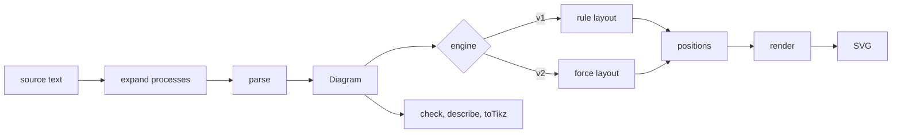

# Architecture

## 1. Reading: `src/parse/`

- **`chains.ts`**, `expandChains`: turns process lines (`p p > t tbar`, `t > b W+`) into ordinary
  edges before anything else sees them. Everything downstream knows only edges.
- **`parse.ts`**, `parse`: a hand-written reader of the edge syntax into a `Diagram`
  (`src/model.ts`): vertices, edges with their `EdgeStyle`, hadron groups and switches. It knows
  nothing about drawing.
- **`src/particles/registry.ts`**: names to styles and labels. `registry.version` changes whenever
  a particle or style is added, which clears the render cache.

## 2. Layout v1: `src/engines/rules/`

`layout.ts` is a list of named steps, each in its own file:

| File | Steps |
|---|---|
| `roles.ts` | which legs enter and leave |
| `columns.ts` | rank each vertex by time; order each column |
| `rows.ts` | settle heights (weighted isotonic regression), mirror, deflect scattered lines |
| `beams.ts` | rails (fermion lines that run through), exchanges, initial-state radiation |
| `cascade.ts` | decay chains: arcs, emissions, stage lengths |
| `arcs.ts` | loops over a line, ladders and boxes, spectators |
| `marks.ts` | marks on a line, spaced evenly |
| `hadrons.ts` | hadrons lined up; vacuum pairs between them |
| `spacing.ts` | clearance: minimum angles, legs clear of other lines |

Every rule and its setting is in [Layout rules](../reference/layout-rules.md), generated from the
code by `node scripts/list-rules.mjs`.

## 3. Layout v2: `src/engines/forces/`

The force engine has three parts:

- **`structure.ts`**, `readStructure`: reads off what the forces need, once. That means the order
  in time, decay generations, heavy and light lines, rails, loops, vacuum pairs, hadrons and
  exchanges.
- **`forces.ts`**: the forces. Each is a list of terms (`{ points, energy }`), weighted by
  `theme.forces`. `allForces` lists them: line length, even angles, time flow, time order,
  clearance, upright exchange, mirrored branches, beams starting together, the final plane, light
  lines outside, heavy lines carrying on, no converging, hadrons, vacuum arcs and loop shapes.
- **`solve.ts`**, `balance`: minimises the total energy with Barzilai-Borwein gradient steps and
  central differences. Clearance terms are skipped while their points are far apart and haven't
  moved enough to matter (exact culling), which keeps it fast.

`engines/forces/layout.ts`, `layoutWithForces`, puts it together: starting positions, balance, then exact
shapes snapped in afterwards (`settlePairs`, `bendAlongCircles`, `bendLoopArcs`).

To add a force: write a function in `forces.ts` returning a `Force`, give it a weight in
`ForceRules` (`src/theme.ts`), add it to `allForces`, and refit the weights if needed
(`scripts/fit/`).

## 4. Drawing: `src/render/`

| File | What it does |
|---|---|
| `render.ts` | `renderDiagram`: layout, then a `Scene`, then the SVG |
| `scene.ts` | the scene being built: bounds, label requests, ids |
| `edge-styles.ts` | final styles: particle styles, arrows, `arrows: none`, `dots: all` |
| `edges.ts` | each line with its arrow, momentum and label |
| `lines.ts` | the line shapes: waves and coils fitted to whole periods, dashes, doubles, cones |
| `vertices.ts` | dots, blobs, insertions |
| `hadrons.ts` | hadron ellipses and braces |
| `panels.ts` | several diagrams side by side |

Labels are placed last: each tries a list of positions and takes the first clear of everything
already drawn. `src/label/label.ts` typesets the TeX subset into SVG text, with widths from a
built-in metrics table, so nothing is measured in the browser. `src/geometry/curve.ts` gives every
line style arc-length lookup along straight and curved paths.

## 5. Tools: `src/tools/`

`check`, `describe` and `toTikz` read the parsed diagram (`prepare.ts`); `measure` lays the diagram
out and scores the result. None of them draws anything.

## The cache

`render` in `src/index.ts` keeps the last 256 results, keyed by the registry version, the options
and the source.
