---
hide:
  - navigation
  - toc
  - tags
tags:
  - Feynman diagram
  - JavaScript
  - SVG
  - TikZ-Feynman
  - MadGraph
  - particle physics
  - HEP
---

# feynjs { .feynjs-hidden }

<div class="feynjs-hero-stage" markdown>

<div class="feynjs-hero-logo" markdown>
{ .feynjs-hero .feynjs-hero--light width="460" }
{ .feynjs-hero .feynjs-hero--dark width="460" }
</div>

<div class="feynjs-hero-showcase" markdown>

<div class="feynjs-hero-tile" markdown>

```feynman
i1 [p] -- pp [blob, pulse] -- i2 [p]
pp -- [gluino] d1
pp -- [gluino] d2
d1 -- f1 [q]
d1 -- f2 [q]
d1 -- [neutralino2] e1
e1 -- f3 [Z]
e1 -- f4 [neutralino1]
d2 -- [neutralino2] e2
e2 -- f5 [neutralino1]
e2 -- f6 [Z]
d2 -- f7 [q]
d2 -- f8 [q]
```

[Full suite of line types](guide/lines.md)

</div>

<div class="feynjs-hero-tile" markdown>

```feynman
colour flow: on
i1 [g] -- a -- i2 [g]
a -- [gluon] b
f1 [t] -- b -- f2 [tbar]
```

[Colour flow](guide/colour-flow.md)

</div>

<div class="feynjs-hero-tile" markdown>

```feynman
i1 [p] -- pp [blob] -- i2 [p]
pp -- [LRJ 1b W(2j)] j1 [J]
pp -- [Z'] z
z -- [SVJ] f1 [\text{SVJ}]
z -- [EMG] f2 [\text{EJ}]
```

[Detector objects](guide/objects.md)

</div>

<div class="feynjs-hero-tile" markdown>

```feynman
view: kinematic
i1 [p] -- pp [blob] -- i2 [p]
pp -- [t] t1
pp -- [tbar] t2
t1 -- b1 [b]
t1 -- [W+] w1
w1 -- l1 [e+]
w1 -- n1 [nu_e]
t2 -- [W-] w2
t2 -- b2 [bbar]
w2 -- q1 [d]
w2 -- q2 [ubar]
```

[Kinematic view](contributing/demos.md#kinematic-view)

</div>

<div class="feynjs-hero-tile" markdown>

```feynman
layout: grid
in: i1 i2
out: b1 l1 n1 q1 q2 b2
i1 [g] -- a
i2 [g] -- a
a -- [g] c
c -- [t] t1
c -- [tbar] t2
t1 -- [W+] w1
t1 -- b1 [b]
w1 -- l1 [e+]
w1 -- n1 [nu_e]
t2 -- [W-] w2
t2 -- b2 [bbar]
w2 -- q1 [d]
w2 -- q2 [ubar]
```

[Grid layout](guide/layout.md)

</div>

<div class="feynjs-hero-tile" markdown>

```feynman
in: d1 b
out: d2 s mu1 mu2
d1 [d] -- [fermion] d2 [d]
s [\bar{s}] -- [fermion] l2 -- [fermion] l1 -- [fermion] b [\bar{b}]
l1 -- [boson, label=W^-] x -- [boson] l2
x -- [photon, label={\gamma, Z^0}] v
v -- [fermion] mu1 [\mu^-]
mu2 [\mu^+] -- [fermion] v
hadron: B^0 = d1 b
hadron: K^{*0} = d2 s
```

[Hadrons](guide/loops-hadrons.md)

</div>

</div>

</div>

Feynman diagrams, welcome to the *web*{ .feynjs-accent }.
{ .feynjs-punch }

***77 years after Feynman, they finally draw themselves. Name the particles and how they meet,
and feynjs lays them out as physics papers do.***
{ .feynjs-lead }

[Get started](get-started/index.md){ .md-button .md-button--primary }
[Read the guide](guide/index.md){ .md-button }
[See examples](examples/index.md){ .md-button }

## Two ways to write a diagram

Draw it line by line, as in TikZ-Feynman, or name the process, as in MadGraph. The two give the
same diagram; use whichever suits it.

```feynman
i1 [e-] -- a -- i2 [e+]
a -- [gamma] b
f1 [mu-] -- b -- f2 [mu+]
```

=== "Edges, as in TikZ-Feynman"

    Every line, written out: you choose each vertex and what joins them.

    ````markdown
    ```feynman
    i1 [e-] -- a -- i2 [e+]
    a -- [gamma] b
    f1 [mu-] -- b -- f2 [mu+]
    ```
    ````

    [Writing edges](guide/syntax.md){ .md-button }

=== "A process, as in MadGraph"

    What goes in, what it passes through, what comes out: feynjs makes the lines.

    ````markdown
    ```feynman
    e- e+ > gamma > mu- mu+
    ```
    ````

    [Writing processes](guide/processes.md){ .md-button }

The process syntax comes into its own for cascades. A gluino pair, each gluino decaying through a
neutralino to a Z, is three lines:

```feynman
p p > gluino gluino
gluino > q q neutralino2
neutralino2 > Z neutralino1
```

````markdown
```feynman
p p > gluino gluino
gluino > q q neutralino2
neutralino2 > Z neutralino1
```
````

## Why feynjs

**Write physics, not coordinates.**
:   There are no positions to place and no styles to pick. Time runs left to right; s-channel,
    t-channel, loops, boxes, cascades and hadrons come out as they are drawn in published papers.

**It knows the particles.**
:   `[e+]`, `[W]`, `[gluino]` set the line, the arrow direction, the label and the colour.
    Nearly a hundred names are built in, and you can [add your own](reference/api.md#registerparticle).

**Syntax you already know.**
:   Write edges as in TikZ-Feynman, `a -- [photon] b`, or processes and decays as in MadGraph,
    `p p > t tbar` and `t > b W+`. Use whichever suits the diagram.

**Plain SVG.**
:   No dependencies and no math engine: labels are typeset in New Computer Modern, the TeX face.
    Diagrams follow the page's light or dark theme, and export as
    [standalone SVG or TikZ](guide/styling.md#exporting).

**Tools as well as pictures.**
:   [`check`](guide/tools.md) lints a diagram, `describe` reads off its process, `measure`
    scores its layout, and the same commands run [from a shell](reference/cli.md).

## A short tour

=== "Gluon fusion"

    ```feynman
    i1 [g] -- a
    i2 [g] -- b
    a -- [fermion] c -- [fermion] b -- [fermion, label=t] a
    c -- [H] f1
    ```

    ````markdown
    ```feynman
    i1 [g] -- a
    i2 [g] -- b
    a -- [fermion] c -- [fermion] b -- [fermion, label=t] a
    c -- [H] f1
    ```
    ````

=== "Higgs-strahlung"

    ```feynman
    i1 [q] -- a -- i2 [qbar']
    a -- [W*] b
    b -- [W] c
    b -- [H] d
    c -- f1 [l]
    c -- f2 [nubar]
    d -- f3 [b]
    d -- f4 [bbar]
    ```

    ````markdown
    ```feynman
    i1 [q] -- a -- i2 [qbar']
    a -- [W*] b
    b -- [W] c
    b -- [H] d
    c -- f1 [l]
    c -- f2 [nubar]
    d -- f3 [b]
    d -- f4 [bbar]
    ```
    ````

=== "Top pair"

    ```feynman
    d dbar > g > t tbar
    t > b W+(> e+ nu)
    tbar > bbar W-(> e- nubar)
    ```

    ````markdown
    ```feynman
    d dbar > g > t tbar
    t > b W+(> e+ nu)
    tbar > bbar W-(> e- nubar)
    ```
    ````

=== "SUSY, as edges"

    ```feynman
    i1 [p] -- pp [blob] -- i2 [p]
    pp -- [gluino] d1
    pp -- [gluino] d2
    d1 -- f1 [q]
    d1 -- f2 [q]
    d1 -- f3 [neutralino]
    d2 -- f4 [neutralino]
    d2 -- f5 [q]
    d2 -- f6 [q]
    ```

    ````markdown
    ```feynman
    i1 [p] -- pp [blob] -- i2 [p]
    pp -- [gluino] d1
    pp -- [gluino] d2
    d1 -- f1 [q]
    d1 -- f2 [q]
    d1 -- f3 [neutralino]
    d2 -- f4 [neutralino]
    d2 -- f5 [q]
    d2 -- f6 [q]
    ```
    ````

=== "Di-Higgs couplings"

    ```feynman
    i1 [g] -- a
    i2 [g] -- b
    a -- [fermion] c -- [fermion] b -- [fermion] a
    c [dot, label=\kappa_t, color=teal] -- [H] v [dot, label=\kappa_\lambda, color=pink]
    v -- f1 [H]
    v -- f2 [H]
    ```

    ````markdown
    ```feynman
    i1 [g] -- a
    i2 [g] -- b
    a -- [fermion] c -- [fermion] b -- [fermion] a
    c [dot, label=\kappa_t, color=teal] -- [H] v [dot, label=\kappa_\lambda, color=pink]
    v -- f1 [H]
    v -- f2 [H]
    ```
    ````

=== "Colour flow"

    ```feynman
    colour flow: on
    i1 [g] -- a -- i2 [g]
    a -- [gluon] b
    f1 [t] -- b -- f2 [tbar]
    ```

    ````markdown
    ```feynman
    colour flow: on
    i1 [g] -- a -- i2 [g]
    a -- [gluon] b
    f1 [t] -- b -- f2 [tbar]
    ```
    ````

=== "Meson decay"

    ```feynman
    in: c1 b
    out: c2 cbar s c3
    c1 [c] -- [fermion] c2 [c]
    cbar [\bar{c}] -- [fermion] v -- [fermion] b [\bar{b}]
    v -- [boson, label=W] w
    s [\bar{s}] -- [fermion] w -- [fermion] c3 [c]
    meson: B_c^+ = c1 b
    meson: J/\psi = c2 cbar
    meson: D_s^+ = s c3
    ```

    ````markdown
    ```feynman
    in: c1 b
    out: c2 cbar s c3
    c1 [c] -- [fermion] c2 [c]
    cbar [\bar{c}] -- [fermion] v -- [fermion] b [\bar{b}]
    v -- [boson, label=W] w
    s [\bar{s}] -- [fermion] w -- [fermion] c3 [c]
    meson: B_c^+ = c1 b
    meson: J/\psi = c2 cbar
    meson: D_s^+ = s c3
    ```
    ````

## Use it anywhere

=== "Docs site"

    In a Zensical or MkDocs site, a `feynman` code block becomes a diagram.
    [Set it up](get-started/use.md#in-a-zensical-or-mkdocs-site) once, then write:

    ````markdown
    ```feynman
    i1 [e-] -- a -- i2 [e+]
    a -- [Z] b
    f1 [nu] -- b -- f2 [nubar]
    ```
    ````

=== "Web page"

    ```html
    <script src="https://cdn.jsdelivr.net/npm/feynjs@0.9/dist/feynjs.min.js"></script>
    <div class="feynman">
      i1 [e-] -- a -- i2 [e+]
      a -- [gamma] b
      f1 [mu-] -- b -- f2 [mu+]
    </div>
    <script>feynjs.run()</script>
    ```

=== "JavaScript"

    ```js
    import { render } from "feynjs";

    const svg = render(`
      i1 [e-] -- a -- i2 [e+]
      a -- [gamma] b
      f1 [mu-] -- b -- f2 [mu+]
    `);
    ```

=== "Command line"

    ```sh
    feynjs render diagram.feyn > diagram.svg
    feynjs tikz diagram.feyn > diagram.tex
    feynjs check diagram.feyn
    ```

## Where next

- **New here?** [Get started](get-started/index.md): install it and draw a first diagram in five minutes.
- **Writing diagrams?** The [guide](guide/index.md) covers every feature, one page per topic.
- **Looking something up?** The [reference](reference/index.md) has the syntax on one page, the
  API, every particle and every theme setting.
- **Want to help?** [Contributing](contributing/index.md) explains how the library is built and how to change it.
