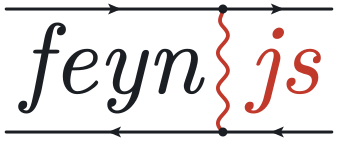

---
hide:
  - navigation
  - toc
  - tags
tags:
  - Feynman diagram
  - JavaScript
  - SVG
  - TikZ-Feynman
  - MadGraph
  - particle physics
  - HEP
---

# feynjs { .feynjs-hidden }

<div class="feynjs-hero-stage" markdown>

<div class="feynjs-hero-logo" markdown>
{ .feynjs-hero .feynjs-hero--light width="460" }
{ .feynjs-hero .feynjs-hero--dark width="460" }

Feynman diagrams, meet *Markdown*{ .feynjs-accent }. *Oh, and the web.*{ .feynjs-aside }
{ .feynjs-punch }

[Getting started](get-started/index.md){ .md-button .md-button--primary }
[Learn more](features.md){ .md-button }

</div>

<div class="feynjs-hero-showcase" markdown>

<div class="feynjs-hero-tile" markdown>

```feynman
colour flow: on
i1 [g] -- a -- i2 [g]
a -- [gluon] b
f1 [t] -- b -- f2 [tbar]
```

[For anywhere](get-started/index.md)

</div>

<div class="feynjs-hero-tile" markdown>

```feynman
i1 [p] -- pp [blob] -- i2 [p]
pp -- [squark] s1
pp -- [squark] s2
s1 -- f1 [q]
s1 -- [neutralino1] n1
n1 -- [EMG] e1 [\text{EJ}]
n1 -- f2 [\chi_d]
s2 -- f3 [q]
s2 -- [neutralino1] n2
n2 -- [EMG] e2 [\text{EJ}]
n2 -- f4 [\chi_d]
```

[Does what you need](features.md)

</div>

<div class="feynjs-hero-tile" markdown>

```feynman
i1 [p] -- pp [blob] -- i2 [p]
pp -- [LRJ 1b W(2j)] j1 [J]
pp -- [Z'] z
z -- [SVJ] f1 [\text{SVJ}]
z -- [EMG] f2 [\text{EJ}]
```

[Detector objects](guide/objects.md)

</div>

</div>

</div>
