---
hide:
  - navigation
  - toc
  - tags
tags:
  - Feynman diagram
  - JavaScript
  - SVG
  - TikZ-Feynman
  - MadGraph
  - particle physics
  - HEP
---

# feynjs { .feynjs-hidden }

<div class="feynjs-splash" markdown>

<div class="feynjs-splash-text" markdown>

{ .feynjs-splash-logo .feynjs-splash-logo--light width="440" }
{ .feynjs-splash-logo .feynjs-splash-logo--dark width="440" }

A JavaScript display engine for *Feynman diagrams*{ .feynjs-accent }
{ .feynjs-punch }

[Learn more](features.md){ .md-button }
[Getting started](get-started/index.md){ .md-button .md-button--primary }

</div>

<div class="feynjs-splash-diagram" markdown>

<div class="feynjs-splash-ripples" aria-hidden="true"><span></span><span></span><span></span><span></span></div>

```feynman
arrows: none
p p > chargino neutralino2
chargino > W neutralino1
neutralino2 > Z neutralino1
W > l nu
Z > l l
```

</div>

</div>
