---
hide:
  - navigation
  - toc
  - tags
tags:
  - Feynman diagram
  - JavaScript
  - SVG
  - TikZ-Feynman
  - MadGraph
  - particle physics
  - HEP
---

# feynjs { .feynjs-hidden }

<div class="feynjs-splash" markdown>

[](#write-it-see-it){ .feynjs-scroll aria-label="See how it works" title="See how it works" }

<div class="feynjs-splash-mark" markdown>
<div class="feynjs-splash-ripples" aria-hidden="true"><span></span><span></span><span></span><span></span></div>
{ .feynjs-splash-logo .feynjs-splash-logo--light width="620" }
{ .feynjs-splash-logo .feynjs-splash-logo--dark width="620" }
</div>

A JavaScript display engine for *Feynman diagrams*{ .feynjs-accent }
{ .feynjs-punch }

[Learn more](features.md){ .md-button }
[Getting started](get-started/index.md){ .md-button .md-button--primary }

</div>

## Write it, see it { #write-it-see-it .feynjs-tour-title }

If you have written TikZ-Feynman, you can already write feynjs. Every diagram here is drawn live, by
your browser, from the text beside it.
{ .feynjs-tour-lead }

<div class="feynjs-row" markdown>
<div class="feynjs-row-text" markdown>

### Multiple syntax support

Write every line, as in TikZ-Feynman, without a `tikzpicture`, coordinates or a compile; or name the process, as in MadGraph. Both draw the same diagram, and feynjs places every vertex itself.

TikZ-Feynman edges
{ .feynjs-code-caption }

```text
i1 [e-] -- a -- i2 [e+]
a -- [photon] b
f1 [mu-] -- b -- f2 [mu+]
```

MadGraph process
{ .feynjs-code-caption }

```text
e- e+ > gamma > mu- mu+
```

</div>
<div class="feynjs-row-diagram" markdown>

```feynman
i1 [e-] -- a -- i2 [e+]
a -- [photon] b
f1 [mu-] -- b -- f2 [mu+]
```

</div>
</div>
<div class="feynjs-row feynjs-row--steps" markdown>
<div class="feynjs-row-text" markdown>

### Drawn in time order

feynjs knows when each particle lives: the collision, then each decay, left to right, as papers draw them. Every part of the drawing knows its step, so a page can build it up one at a time.

```text
p p > H
H > Z Z
Z > l+ l-
```

</div>
<div class="feynjs-row-diagram" markdown>

```feynman
p p > H
H > Z Z
Z > l+ l-
```

</div>
</div>
<div class="feynjs-row" markdown>
<div class="feynjs-row-text" markdown>

### Particles draw themselves

A particle's name brings its line, arrow, label and colour: superpartners in red, a W wavy, a Higgs dashed. Over a hundred names are built in.

```text
arrows: none
p p > chargino neutralino2
chargino > W neutralino1
neutralino2 > Z neutralino1
W > l nu
Z > l l
```

</div>
<div class="feynjs-row-diagram" markdown>

```feynman
arrows: none
p p > chargino neutralino2
chargino > W neutralino1
neutralino2 > Z neutralino1
W > l nu
Z > l l
```

</div>
</div>
<div class="feynjs-row" markdown>
<div class="feynjs-row-text" markdown>

### Loops in braces

Put a particle in braces to run it round a loop: the top-quark triangle of Higgs production by gluon fusion is one line.

```text
g g > {t} > H
```

</div>
<div class="feynjs-row-diagram" markdown>

```feynman
g g > {t} > H
```

</div>
</div>
<div class="feynjs-row feynjs-row--morph" markdown>
<div class="feynjs-row-text" markdown>

### Two layout engines

The force engine balances the diagram until it settles; the grid engine puts every line on a grid.
One line switches between them, and the same diagram moves from one to the other.

```text
layout: grid
p p > t t~
t > b W+(> e+ ve)
t~ > b~ W-(> d u~)
```

</div>
<div class="feynjs-row-diagram" markdown>

```feynman
p p > t t~
t > b W+(> e+ ve)
t~ > b~ W-(> d u~)
```

</div>
</div>
<div class="feynjs-row" markdown>
<div class="feynjs-row-text" markdown>

### More than lines

The final states a detector sees, drawn as it sees them: large-R jets with what they hold, semi-visible and emerging jets, missing energy. A pulse draws the eye where it should go.

```text
i1 [p] -- pp [blob, pulse] -- i2 [p]
pp -- [LRJ 1b W(2j)] j1 [J]
pp -- [Z'] z
z -- [SVJ] f1 [\text{SVJ}]
z -- [EMG] f2 [\text{EJ}]
```

</div>
<div class="feynjs-row-diagram" markdown>

```feynman
i1 [p] -- pp [blob, pulse] -- i2 [p]
pp -- [LRJ 1b W(2j)] j1 [J]
pp -- [Z'] z
z -- [SVJ] f1 [\text{SVJ}]
z -- [EMG] f2 [\text{EJ}]
```

</div>
</div>

<div class="feynjs-row feynjs-row--anywhere" markdown>
<div class="feynjs-row-text" markdown>

### Wherever you write

The same text is a diagram in a Markdown site, in an Obsidian note, on any web page with one script
tag, and in a LaTeX paper, where it becomes TikZ-Feynman code.

[Getting started](get-started/index.md){ .md-button .md-button--primary }
[Try the playground](playground.md){ .md-button }

</div>
<div class="feynjs-row-diagram feynjs-row-code" markdown>

````markdown
```feynman
g g > {t} > H
```
````

```latex
\begin{feynjs}
g g > {t} > H
\end{feynjs}
```

</div>
</div>
